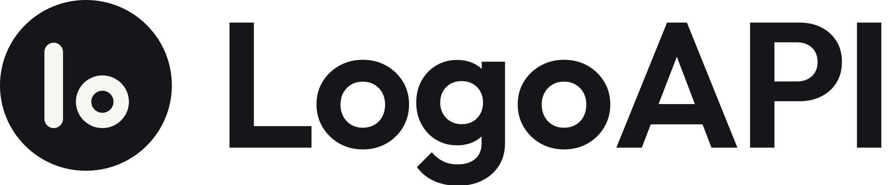

<p align="center">
  <a href="https://logoapi.sh?utm_source=github&utm_medium=readme&utm_campaign=logo-api">
    <picture>
      <source media="(prefers-color-scheme: dark)" srcset=".github/assets/logoapi-wordmark-dark.svg">
      
    </picture>
  </a>
</p>

<h1 align="center">Free logo API: company logos by domain</h1>

<p align="center">
  <b>One URL returns the SVG. No API key, no signup, no attribution.</b><br>
  A free alternative to the Clearbit Logo API. 2M requests a month per site. Commercial use included.
</p>

<p align="center"><code>&lt;img src="https://logoapi.sh/stripe.com.svg" alt="Stripe"&gt;</code></p>

<p align="center">
  This repo holds part of the catalog. The <a href="https://logoapi.sh?utm_source=github&utm_medium=readme&utm_campaign=logo-api">logoapi.sh</a> CDN serves all 5,000+ logos. We add more here when the licence allows.
</p>

<p align="center">
  <a href="https://logoapi.sh?utm_source=github&utm_medium=readme&utm_campaign=logo-api"></a>
  <a href="logos/"></a>
  <a href="https://logoapi.sh/docs?utm_source=github&utm_medium=readme&utm_campaign=logo-api"></a>
  <a href="https://logoapi.sh/docs?utm_source=github&utm_medium=readme&utm_campaign=logo-api"></a>
  <a href="https://logoapi.sh/pricing?utm_source=github&utm_medium=readme&utm_campaign=logo-api"></a>
  <a href="LICENSE"></a>
</p>

<p align="center">
  <a href="https://logoapi.sh/docs?utm_source=github&utm_medium=readme&utm_campaign=logo-api">Docs</a> ·
  <a href="https://logoapi.sh/finder?utm_source=github&utm_medium=readme&utm_campaign=logo-api">Logo Finder</a> ·
  <a href="https://logoapi.sh/pricing?utm_source=github&utm_medium=readme&utm_campaign=logo-api">Pricing</a> ·
  <a href="https://logoapi.sh/blog/clearbit-logo-api-migration?utm_source=github&utm_medium=readme&utm_campaign=logo-api">Migrating from Clearbit</a>
</p>

<br>

<p align="center">
  <picture><source media="(prefers-color-scheme: dark)" srcset="https://logoapi.sh/dark/stripe.com.svg"></picture>&nbsp;&nbsp;&nbsp;&nbsp;
  <picture><source media="(prefers-color-scheme: dark)" srcset="https://logoapi.sh/dark/github.com.svg"></picture>&nbsp;&nbsp;&nbsp;&nbsp;
  <picture><source media="(prefers-color-scheme: dark)" srcset="https://logoapi.sh/dark/slack.com.svg"></picture>&nbsp;&nbsp;&nbsp;&nbsp;
  <picture><source media="(prefers-color-scheme: dark)" srcset="https://logoapi.sh/dark/spotify.com.svg"></picture>&nbsp;&nbsp;&nbsp;&nbsp;
  <picture><source media="(prefers-color-scheme: dark)" srcset="https://logoapi.sh/dark/figma.com.svg"></picture>&nbsp;&nbsp;&nbsp;&nbsp;
  <picture><source media="(prefers-color-scheme: dark)" srcset="https://logoapi.sh/dark/vercel.com.svg"></picture>
</p>

<p align="center"><sub>Every logo above is a live response from logoapi.sh, with the dark mode version on dark themes.</sub></p>

---

## Using this from an AI agent or sandbox

- Start here: `https://raw.githubusercontent.com/AlonHarpaz/logo-api/main/index.json`. Look up the domain or the stock ticker there, then fetch the path it gives you.
- Files are NOT named by domain. `logos/apple.com.svg` and `logos/<domain>/logo.svg` do not exist. Names are slugs, such as `logos/apple.svg`, so always go through `index.json`.
- Shape: `{"domains": {"apple.com": "logos/apple.svg"}, "tickers": {"AAPL": "logos/apple.svg"}}`
- Raw URL pattern: `https://raw.githubusercontent.com/AlonHarpaz/logo-api/main/<path>`, for example `.../main/logos/apple.svg`.
- Files in this repo are CC0 (public domain). Logos remain trademarks of their owners: use them to identify the company, and don't suggest the company endorses you. Full catalog and terms: https://logoapi.sh.
- The full catalog (5,000+ logos, tickers, crypto, PNG) is on the API: `https://logoapi.sh/<domain>`, `https://logoapi.sh/ticker/<SYM>` and `https://logoapi.sh/icon/ticker/<SYM>`.
- Tickers: `index.json` has a `tickers` map, and the API serves `https://logoapi.sh/ticker/<SYM>`. ETFs map to the issuer (SPY goes to ssga.com).
- Stock tickers also sit at `tickers/<SYMBOL>.svg` (same files, predictable names), for example `.../main/tickers/AAPL.svg`.
- Official square marks (trademarks, not CC0) for the top US tickers and main coins sit at `official/tickers/<SYMBOL>.svg` and `official/crypto/<SYMBOL>.svg`, map in `official/index.json`, terms in `official/LICENSE.md`. See [official/README.md](official/README.md).
- Right now `index.json` lists 1,174 domains and 50 tickers, and every path in it exists.
- If outside hosts are blocked, connect the MCP server `https://logoapi.sh/mcp`, or ask the user to allow `logoapi.sh`.

---

## Quick start

Swap the domain. That's it.

```html

```

```bash
curl -I https://logoapi.sh/stripe.com.svg
# HTTP/2 200
# content-type: image/svg+xml
# access-control-allow-origin: *
```

An unknown domain gets the site's live favicon, then a letter tile. Add `?fallback=404` to get a plain `404` and run your own fallback.

## Routes

| What you need | URL |
| --- | --- |
| Wordmark logo | `https://logoapi.sh/{domain}.svg` |
| Square icon | `https://logoapi.sh/icon/{domain}.svg` |
| Favicon | `https://logoapi.sh/favicon/{domain}` |
| White, black, grey, dark mode | `https://logoapi.sh/{white\|black\|grey\|dark}/{domain}.svg` |
| Name to domain | `https://logoapi.sh/search?q=stripe` |
| Clearbit-style bare domain | `https://logoapi.sh/{domain}` |

Full reference with real responses: [logoapi.sh/docs](https://logoapi.sh/docs?utm_source=github&utm_medium=readme&utm_campaign=logo-api)

## Examples

**React**

```jsx
function CompanyLogo({ domain, name }) {
  return (
     { e.currentTarget.style.display = "none"; }}
    />
  );
}
```

**Dark mode**

```html
<picture>
  <source media="(prefers-color-scheme: dark)" srcset="https://logoapi.sh/dark/stripe.com.svg">
  
</picture>
```

**Only have a company name?**

```bash
curl "https://logoapi.sh/search?q=stripe"
```

```json
{
  "query": "stripe",
  "results": [
    {
      "domain": "stripe.com",
      "name": "Stripe",
      "logo": "https://logoapi.sh/stripe.com.svg",
      "icon": "https://logoapi.sh/icon/stripe.com.svg",
      "tags": ["finance"]
    }
  ]
}
```

## Coming from Clearbit?

The Clearbit Logo API (`logo.clearbit.com`) has shut down. Change the host and keep the domain:

```diff
- https://logo.clearbit.com/stripe.com
+ https://logoapi.sh/stripe.com
```

Step-by-step guide: [Clearbit Logo API migration](https://logoapi.sh/blog/clearbit-logo-api-migration?utm_source=github&utm_medium=readme&utm_campaign=logo-api)

## Use as an agent skill

An [Agent Skill](skills/company-logos/SKILL.md) teaches coding agents to add the right logo URL (domain, ticker, icon, PNG for email, no-code builders). Install:

```sh
npx skills add AlonHarpaz/logo-api
```

Or copy `skills/company-logos/` into your tool's skills folder:

| Tool | Project path |
|---|---|
| Claude Code | `.claude/skills/company-logos/` |
| Codex | `.agents/skills/company-logos/` |
| GitHub Copilot | `.github/skills/company-logos/` |
| Cursor | `.cursor/skills/company-logos/` |

## Pricing

**Free:** 2M requests a month per site. No key, no attribution required.
**Pro (waitlist):** $29 a month for 10M requests a month and email support. Join at [logoapi.sh/pricing](https://logoapi.sh/pricing?utm_source=github&utm_medium=readme&utm_campaign=logo-api).
Details: [logoapi.sh/pricing](https://logoapi.sh/pricing?utm_source=github&utm_medium=readme&utm_campaign=logo-api)

**Do I have to credit LogoAPI.sh?** No. No attribution is required, for personal or commercial projects.

## What's in this repo

This repo holds the open logo files behind LogoAPI.sh: 2,016 SVGs in the public domain under [CC0](LICENSE). Provenance and the pinned source commit are in the LICENSE file.

The hosted API serves the full catalog of 4,138 brands, with wordmarks, icons, colour versions and
search. The API service itself is not in this repo.

## Contributing

- **Missing, wrong or outdated logo?** [Open an issue](../../issues/new/choose). The forms ask for the domain and a link to the official file.
- **You own a brand and want its logo changed or removed?** Use [logoapi.sh/claim](https://logoapi.sh/claim?utm_source=github&utm_medium=readme&utm_campaign=logo-api). We reply within 2 business days.

## License

Logo files in this repo: [CC0 1.0](LICENSE).
Logos remain trademarks of their owners. Use them to refer to the company, not to imply endorsement.

<p align="center"><sub>LogoAPI.sh is operated by H. Tech Innovation LLC, Dallas, TX.</sub></p>
